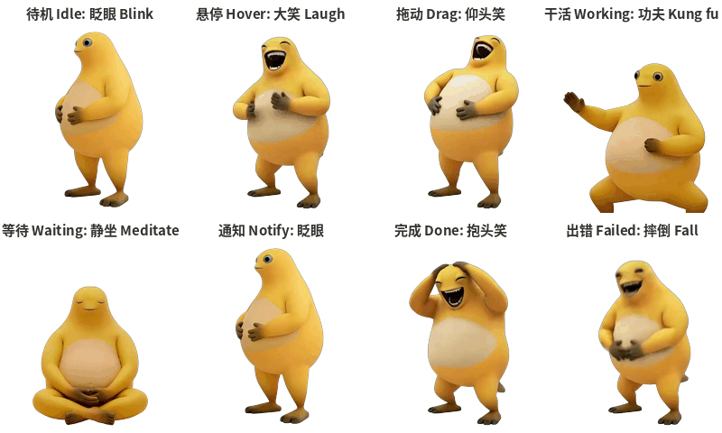

# Naiwa Laughing · Codex Desktop Pet

[中文](README.md) | English

A desktop pet for OpenAI Codex: it blinks quietly while idle, bursts into a doubled-over belly laugh when you hover over it, practices kung fu while Codex is working, meditates while waiting for you, and laughs so hard it falls over when something fails.



## Animations by state

| Codex state | When it shows | What Naiwa does |
|---|---|---|
| idle | Most of the time | Blinks, eyes slowly drift toward you |
| jumping | Mouse hovering over the pet | **Doubled-over belly laugh** |
| running-left / right | Dragging the pet | Head-back laugh |
| running | Codex is working on a task | Kung fu |
| waiting | Waiting for your approval or reply | Meditating |
| waving | A new notification | Quick blink |
| review | Task finished, result unread | Hands-on-head laugh |
| failed | Task failed or was cancelled | Laughs until it falls over and rolls |

## Install

Requires the [Codex desktop app](https://openai.com/codex/) (or the ChatGPT desktop app with Codex).

**Option 1: one command (macOS / Linux)**

```bash
curl -fsSL https://raw.githubusercontent.com/WentaoZhu626/naiwa-codex-pet/main/install.sh | bash
```

**Option 1: one command (Windows PowerShell)**

```powershell
irm https://raw.githubusercontent.com/WentaoZhu626/naiwa-codex-pet/main/install.ps1 | iex
```

**Option 2: manual**

1. Download this repo (Code → Download ZIP) and unzip it.
2. Copy the whole `pets/naiwa-laugh` folder into:
   - macOS / Linux: `~/.codex/pets/`
   - Windows: `%USERPROFILE%\.codex\pets\`
   - If you set `CODEX_HOME`, use `$CODEX_HOME/pets/` instead
3. You should end up with:

   ```text
   ~/.codex/pets/naiwa-laugh/
   ├── pet.json
   └── spritesheet.webp
   ```

**Then:** open Codex → Settings → Appearance → Pets and pick **"奶蛙大笑"**. Restart Codex if it doesn't show up.

## FAQ

**I updated the files but Codex still shows the old version?**
The first time Codex sees a custom pet, it uploads it to your account and keeps using that cloud copy, so later local edits are ignored. To switch to a new version, delete the old "奶蛙大笑" in Pets settings, then reinstall the folder under a new name (e.g. `naiwa-laugh-2`).

**Why does the hover laugh stop after a few seconds?**
That's how Codex works: every state except idle plays 3 times per trigger and then returns to idle. Idle is also slowed down 6×, which is why it uses a slow blink.

**The pet doesn't move at all?**
Check whether Reduce Motion is on (macOS: System Settings → Accessibility → Display → Reduce motion). With it on, Codex shows a still frame only.

## Files

```text
pets/naiwa-laugh/pet.json          Pet manifest
pets/naiwa-laugh/spritesheet.webp  1536×1872 sprite atlas (8 columns × 9 rows, 192×208 cells)
install.sh / install.ps1           Install scripts
assets/                            Preview images
```

The atlas follows the Codex custom pet format ([openai/skills · hatch-pet](https://github.com/openai/skills/tree/main/skills/.curated/hatch-pet)) and passes the official validation script.

## Credits

The frames come from Naiwa videos and pictures found online, cut out and arranged into a sprite sheet. For personal, non-commercial fun only.
